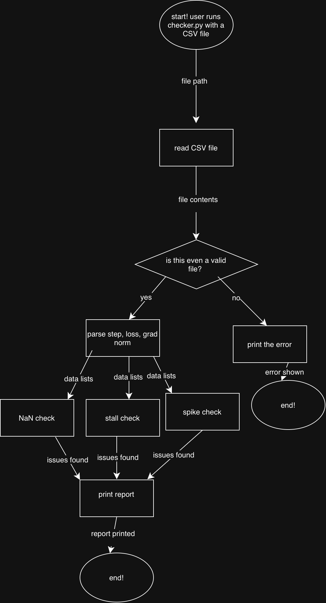

# Training Log Checker

A command-line tool that looks through AI training logs and tries to catch early warning signs that something might be going wrong during a training run.

## Project Goal

When training an AI model, things can sometimes go wrong without there being any obvious signs at first. Loss might stop improving, gradients could suddenly explode, and you might not notice until hours or even days of compute have already been wasted.

I ran into this myself while researching failure modes in multi-agent reinforcement learning ([paper](https://arxiv.org/abs/2604.04983)), and it ended up costing me weeks of debugging. I wanted to build something that could help catch these issues earlier. This tool reads a training log and flags possible problems, hopefully catching them in minutes instead of weeks.

## MVP Scope

Version 1.0 will:

- Read a training log CSV (with columns for step, loss, and gradient norm) provided through the command line
- Check for NaN or infinite values and show the step where they first appear
- Flag stalled loss when there hasn't been much improvement over the last N steps
- Flag exploding gradients when there's a sudden spike compared to the recent average
- Print a summary of the problems it finds and roughly when they started

## Future Plans (V2.0+)

Some things I'd like to add in future versions:

- Allow users to set their own thresholds using command-line flags (stall window, spike size, etc.)
- Plot the loss curve and mark where problems seem to occur
- Let users save the report as a JSON or text file
- Add a watch mode that checks the log while training is still running

## Tech Stack

- **Language:** Python
- **Libraries:** `csv`, `math`, and `argparse` (all built into Python); `matplotlib` for plotting in V2
- **Data storage:** None needed for now. The tool just reads existing CSV log files and prints the results in the terminal.
- **Data sources:** CSV logs exported from training runs, along with some sample CSV files in `tests/` for testing
- **Version control:** Git/GitHub

## Usage (planned)

```bash
python src/checker.py path/to/training_log.csv
```

## Repository Structure

```text
src/      source code
tests/    sample training logs for testing
docs/     Eisenhower matrix and system diagram
```

## Design Docs

- [Eisenhower Matrix](docs/eisenhower-matrix.pdf)
- 
